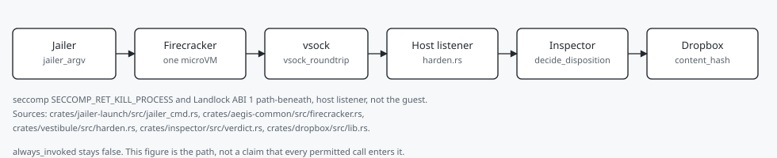
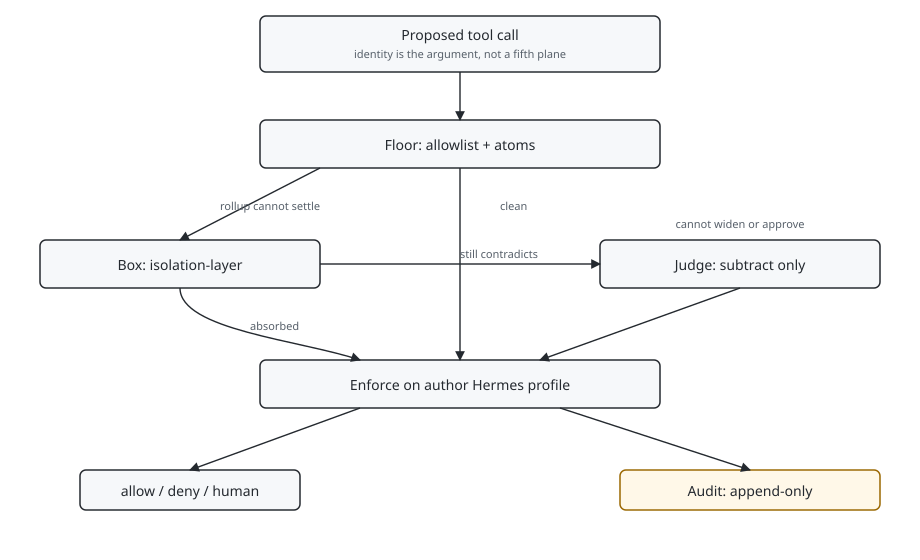

# isolation-layer

An execution-isolation box for runtime agents. Each live, full-capability execution runs as an **ephemeral Firecracker microVM, one per task, launched under the jailer, destroyed on completion.**

The four planes take identity as an argument. The floor decides. The box sits between floor and judge. The judge subtracts. The audit attests. This tree is the box: it runs when the floor cannot settle the call, not everything the floor permits.

A tool call meets capability-gate first. A contradiction the atom-plane rollup cannot settle is the handoff to this tree: run it somewhere disposable, kill it if it is malicious. The three-object model that produces that contradiction lives on [aegis-atoms](https://github.com/Steck43/aegis-atoms). The box absorbs it before a judge call is paid for; only what still contradicts reaches the judge, which may concur, flag, tighten or escalate, and may never widen or approve. Whatever none of them settles binds to a human.

Containment is the cost of surgical denial, not the goal. This ordering is design intent, not a forced path: today a tool call meets the allowlist and runs, and `always_invoked_claim` stays false until a named prove says otherwise.

## Four-plane path

This roof is the box. The floor is [capability-gate](https://github.com/Steck43/capability-gate). The atom plane and the judge are [aegis-atoms](https://github.com/Steck43/aegis-atoms). The labs that show which classes still fire are [owasp-dual-top10-lab](https://github.com/Steck43/owasp-dual-top10-lab) and [newwave-owasp-security-lab](https://github.com/Steck43/newwave-owasp-security-lab). `always_invoked` stays false.





Author: [Landen Stecker](https://github.com/Steck43)

## Why a microVM and not a sandbox

The design is chosen against one threat: **an agent that disables its own fence.**

Leonardo Di Donato documented this class for Ona in February and March 2026: a coding agent escaped a bubblewrap sandbox by using `/proc/self/root` as a denylist synonym for a blocked path, then tried to disable bubblewrap once caught ([How Claude Code Escapes its Own Denylist and Sandbox](https://ona.com/stories/how-claude-code-escapes-its-own-denylist-and-sandbox)). The failure was structural, not a missing rule. The fence and the fenced shared a trust domain, and a denylist that enumerates badness loses to an opponent that routes around it.

A Firecracker microVM removes the shared domain rather than hardening it. The boundary is enforced by KVM in the host kernel and by a separate guest kernel. It is not an object inside the guest: no namespace to unshare, no LSM policy to disable, no fence process in the guest's PID table to kill. Firecracker exposes five emulated devices: virtio-net, virtio-block, virtio-vsock, serial console, and a minimal keyboard controller. Everything not implemented is attack surface that does not exist.

The jailer sits underneath as a backstop, wrapping the Firecracker process itself in cgroups, namespaces, seccomp, and a chroot and dropping privileges before the guest runs. Two boundaries: the VM is primary, the jailer catches a hypothetical VMM-barrier compromise in a jailed host process rather than as root on the host.

The alternatives were considered and rejected on the record, not overlooked. Plain containers share the host kernel, which is the same weakness the escape class exploits. Docker is runtime, packaging and test infrastructure, never the isolation boundary. This repo has no Dockerfile. bubblewrap with Landlock and seccomp is the exact configuration that was escaped. gVisor is strong and needs no hardware virtualization, but its boundary is a user-space kernel processing guest syscalls, a wider surface than KVM plus five devices; it is the named fallback, not a shipped runtime (`git grep` finds it in docs, not in `crates/`). WebAssembly is the wrong shape for code that needs a real filesystem and subprocesses.

ASI05 Unexpected Code Execution is the class this contains: one microVM per task under the jailer, seccomp default KILL, Landlock on the host listener. That control is built and tested, and untested live on the full path, because the box is not invoked on every permitted call. ASI07 is not mapped.

## Claim tense

Every claim in this repository carries its evidence rung. The distinction is load-bearing and is enforced in the docs.

| Tag | Meaning |
|---|---|
| `RECORD` | Off-the-shelf and proven today. Shipped code, a real primitive, or a verified source is named. |
| `VISION` | A target or design intent. Not yet standing. |
| `SOURCE:` | The primary source named *before* the claim that rests on it. |
| `ASSUMPTION (verify):` | An input taken on faith, with the exact check to run. |

Building a thing and watching it work does not promote a claim by itself. A boundary probe with a named negative control does.

## What is shipped

Rust workspace, six crates:

| Crate | Role |
|---|---|
| `isolation-manager` | Launch, prove (receipt bound to call id plus gate and atoms digests), inspect, and allowlisted host-path read (observe; `always_invoked_claim` stays false). Host entry `scripts/box_entry.py` emits the CI receipt contract by default; with `BOX_LIVE_PROVE=1` it boots the same prove path under the caller `tool_call_id`. |
| `jailer-launch` | Jailer invocation and privilege drop. |
| `vestibule` | Seccomp allowlist, **default KILL**. Landlock filesystem allowlist. |
| `inspector` | Post-run verdict and host-disposition checks. |
| `dropbox` | Bounded artifact hand-back across the boundary. |
| `aegis-common` | Shared paths, validation, host snapshot. |

`RECORD` — currently green: Landlock filesystem allowlist, seccomp allowlist defaulting to KILL, cgroup memory and pid limits on the listener, a `PROT_EXEC` argument filter, and vsock as the control plane. The prove run reports `landlock=true`, `cgroup_jail=true`.

`VISION` — next: always-invoked enforcement, a full filesystem manifest, a dedicated vestibule uid, and richer analyzers.

## Controls and status

| Control | Status | Proof |
|---|---|---|
| One Firecracker microVM per task under the jailer | built and tested | `crates/jailer-launch/src/jailer_cmd.rs:5` `jailer_argv`; CI job `rust (cargo test)` |
| seccomp default KILL and the PROT_EXEC filter on the host listener | built and tested | `crates/vestibule/src/harden.rs:532` `SECCOMP_RET_KILL_PROCESS`; `harden.rs:445` `PROT_EXEC` |
| Landlock ABI 1 path-beneath allowlist on the host listener | built and tested | `crates/vestibule/src/harden.rs:157` `install_landlock` |
| Handoff on the one rollup status | built and tested | the dry handoff script under `scripts/`; it does not boot unless `--launch` |
| Public-surface scanner | enforced in CI | job `public surface (scanner from base)` |
| Recorded cold start | built and tested | `docs/b1-record.md` lines 110 to 118: 958.6 ms jailed, 1700.8 ms direct, nested Hyper-V. Not rerun this sitting |

## Substrate, stated honestly

The primary substrate is a **dedicated Linux VM**, with Firecracker as an L1 guest.

That is not the original design. A preflight found the Microsoft WSL2 kernel ships without `CONFIG_VHOST_VSOCK`, which blocks the vsock control plane on the WSL2-direct path and is not fixable by loading a module. Promoting a dedicated VM resolved it and shrank the trusted computing base at the same time, since Firecracker stops being a nested L2 guest.

Two things this repository will not claim:

- **Not "125 ms."** That is Firecracker's bare-metal reference figure and it is not this host's number. Measured here, cold, no snapshot, Firecracker as an L1 guest under nested Hyper-V: time to guest userspace **958.6 ms jailed** and **1700.8 ms direct** (`docs/b1-record.md` section 5, RECORD). Snapshot-restore is not measured and stays VISION, so no warm-start figure is quoted either.
- **Not "maximum isolation."** Under nesting the effective trust base includes the hypervisor's nested-KVM path. There is no cheap local proof that nested KVM preserves guest isolation equivalent to single-level KVM, so it is carried as trusted-but-unproven rather than asserted.

## Boundary suite

The probe suite is **fail-first**: every probe has a named negative control, and a probe that cannot be made to fail on purpose does not count as passing. Host-to-VM is treated as untrusted-input surface and carries its own probe class, because introducing the VM introduced that boundary.

Step 10 (`scripts/step10_live_harness.py`) joins a real capability-gate decision and a real atoms evaluate into the prove bind args on one call id. Unit tests recompute those digests without booting. Live jailer prove on the box is gated on `BOX_LIVE_PROVE=1`. Step 10b re-ran that prove on a clean `main` tip checkout (receipt `receipts/STEP-10b-2026-10-09.md`). `scripts/box_entry.py` remains the CI receipt contract and does not boot the jailer. `always_invoked` stays false.

## Status

Active research build. Interfaces are not stable. This is a working isolation layer for one to two local agents, not a multi-tenant control plane, and it deliberately does not inherit the cloud orchestration of the projects whose lifecycle and vsock patterns it studied.

Default-branch docs do not stamp tip SHAs. Those hashes were local-session locators and go stale after a history rewrite.

## How to run

From a Linux shell, because the vestibule crate uses seccomp and Landlock:

```
cargo test --workspace
python3 -m pytest -q
```

The dry handoff script under `scripts/` prints its ok line and does not boot. `--launch` is the live path.

## Tests and proof

Commands run on this head are recorded in the pull request body after they finish. CI job names on the default branch: `secrets (gitleaks)`, `authorship (no AI trailers)`, `tests`, `rust (cargo test)`, `lint (ruff)`, `craft (voice)`, `craft (changelog)`, `craft (comments)`, `workflow (zizmor + actionlint)`, `public surface (scanner from base)`.

The Python suite baseline on `1a59a9a` was 1,830 passed and 5 skipped on Linux. This sitting reruns it and names the machine in the pull request. Cargo was not part of that baseline.

## Known limits

- `always_invoked` is false. The box is not on the path of every permitted call. That full path is untested live.
- The same-user story is not this repo's log. The cold-start figure is the nested measurement above, not a bare-metal 125 ms.
- The handoff script is dry unless `--launch`. It accepts one rollup status.
- `LICENSE` is MIT. `Cargo.toml` declares Apache-2.0. The split is named.
- gVisor is a named fallback. There is no `runsc` in this repo.
- Mutation counts are not stated. That claim is retired.

## Related work

- Stecker, L. (2026). capability-gate. Zenodo. https://doi.org/10.5281/zenodo.22018052. Sibling layer. The prove receipt binds a gate digest and an atoms digest to one call id. Borrows the concept record. Differs: this tree is the box, and it is not invoked on every permitted call.
- Agache et al. (2020). Firecracker. NSDI. https://www.usenix.org/conference/nsdi20/presentation/agache. Borrows the KVM microVM and the small device set. Differs: nested L1 guest, and the measured cold start is 958.6 ms jailed.
- Firecracker jailer. https://github.com/firecracker-microvm/firecracker/blob/main/docs/jailer.md. Borrows the jailer as the second boundary. `jailer_argv` wraps it.
- Linux seccomp BPF. https://docs.kernel.org/userspace-api/seccomp_filter.html. Borrows a default-KILL allowlist and the PROT_EXEC filter on the host listener.
- Linux Landlock. https://docs.kernel.org/userspace-api/landlock.html. Borrows an ABI 1 path-beneath allowlist on the host listener, not in the guest.
- gVisor. https://gvisor.dev/docs/. Differs. Named fallback. The boundary here is KVM plus a guest kernel, not a user-space kernel.
- Kata Containers architecture. https://github.com/kata-containers/kata-containers/blob/main/docs/design/architecture/README.md. Differs. This repo drives Firecracker directly and does not inherit cloud orchestration.

## License

`LICENSE` is MIT. The Cargo workspace (`Cargo.toml`) declares `Apache-2.0`. That split is named, not silently flipped.

Landen Stecker, agentic AI engineer and architect with security built in.
